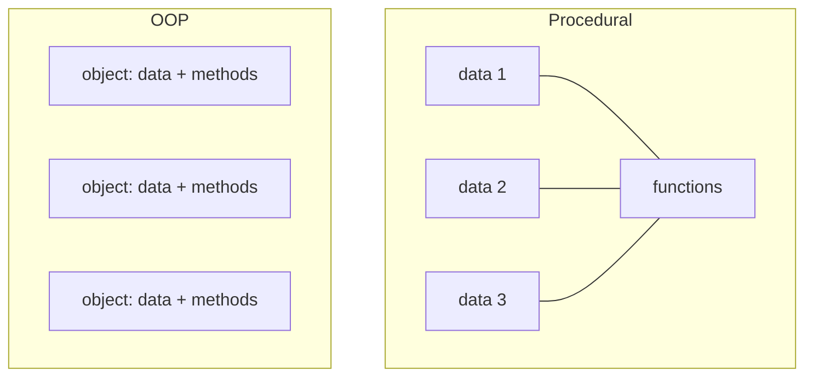
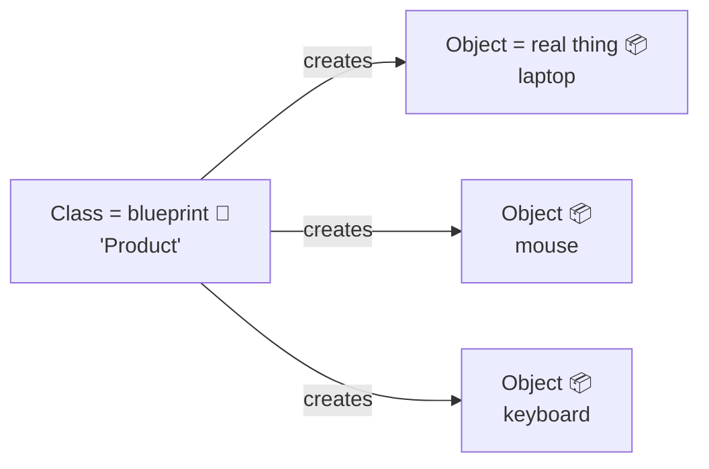
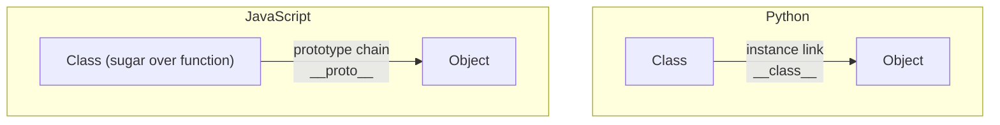

# 02 — Why OOP? The Big Picture 🌍

## What is OOP, in one sentence?

> **OOP = bundling data (attributes) and the actions that work on that data (methods) into one thing called an *object*.**

---

## 🏠 Real-life analogy: The Restaurant

Imagine a restaurant with no structure — ingredients everywhere, recipes on loose papers, anyone can touch anything. Chaos.

OOP is like organizing the restaurant into **stations**:

```
🍳 Kitchen Station   →  has ingredients (data) + can cook() (action)
💳 Billing Counter   →  has menu prices (data) + can generateBill() (action)
🧑‍🍽️ Waiter           →  has order list (data) + can takeOrder() (action)
```

Each station **owns its data** and **knows its job**. The waiter doesn't need to know HOW the kitchen cooks — just that `cook()` exists.

That's the whole philosophy of OOP.

---

## Procedural vs OOP — feel the difference

### Procedural: data and logic are separate 🐍

```python
# Data floats around loosely
laptop_name = "Laptop"
laptop_price = 60000
mouse_name = "Mouse"
mouse_price = 1000

def total_price(price, quantity):
    return price * quantity

def apply_discount(price, pct):
    return price - (price * pct / 100)

# Works... but with 50 products you drown in variables
# and ANY function can touch ANY data (no protection)
```

### OOP: data + logic travel together

```python
class Product:
    def __init__(self, name, price):
        self.name = name          # data
        self.price = price        # data

    def total_price(self, quantity=1):       # logic lives WITH the data
        return self.price * quantity

    def apply_discount(self, pct):
        return self.price - (self.price * pct / 100)

laptop = Product("Laptop", 60000)
mouse = Product("Mouse", 1000)

laptop.total_price(2)     # 120000 — the object does the work itself
```

**The object is like a self-contained package** — it carries its own data AND the operations on it.



---

## The 4 Pillars of OOP 🏛️

```mermaid
mindmap
  root((OOP))
    Encapsulation
      Bundle data + methods
      Hide internals
      "Don't touch my private stuff"
    Abstraction
      Show only what's needed
      Hide complexity
      "Just press the brake pedal"
    Inheritance
      Child reuses parent's features
      "Dog IS-A Animal"
    Polymorphism
      Same method name, different behavior
      "Every animal .speak()s differently"
```

| Pillar | One-line meaning | Real-life |
|--------|------------------|-----------|
| **Encapsulation** | Keep data + code together; protect data from outside meddling | ATM hides your PIN handling; you only use the keypad |
| **Abstraction** | Expose a simple interface; hide messy internals | You drive a car without knowing the engine's mechanics |
| **Inheritance** | Child class gets parent's features for free | A `Car` inherits wheels/engine from `Vehicle` |
| **Polymorphism** | Same action name, different behavior per object | `draw()` draws a circle OR a square depending on the shape |

We'll dedicate a full chapter to each.

---

## The two vocabulary words you'll see forever



- **Class** = the blueprint / cookie cutter / design document
- **Object (instance)** = the actual thing built from the blueprint / the cookie

🏠 *Analogy:* The architect's plan for a house = **class**. Each actual house built from it = **object**. One plan → many houses, each with its own paint color (its own data).

---

## Why OOP exists — the problems it solves

| Problem without OOP | How OOP fixes it |
|---------------------|------------------|
| 500 variables named `user1_name`, `user2_name`... | Objects group related data |
| Any function can corrupt any data | Encapsulation + private fields |
| Copy-pasting similar code | Inheritance reuses parent code |
| `if type == "email": ... elif type == "sms":` | Polymorphism — each class knows its own behavior |
| Need to know every internal detail | Abstraction — simple public interface |

---

## 🆚 Python vs JS — two flavors of OOP



| | Python 🐍 | JavaScript ⚡ |
|---|-----------|----------------|
| Under the hood | Classes are real type objects created by a **metaclass** (`type`) | `class` is **syntactic sugar** over **prototypes** — objects inherit directly from other objects |
| Instance link | `obj.__class__` → class | `obj.__proto__` → `Class.prototype` |
| Call syntax | `obj.method()` auto-passes `self` | `obj.method()` sets `this` at call time |
| True privacy | `__name` (name-mangled, still reachable) | `#name` (hard private, unreachable) |

Both give you the same 4 pillars — the machinery underneath just differs. We'll go deep in file 09.

---

## ✅ Mental model to carry forward

> A **class** is a *recipe*. An **object** is a *dish cooked from it*.
> `self`/`this` is how a method says "**my** ingredients" vs. someone else's.

➡️ **Next:** `03-classes-and-objects.md`
