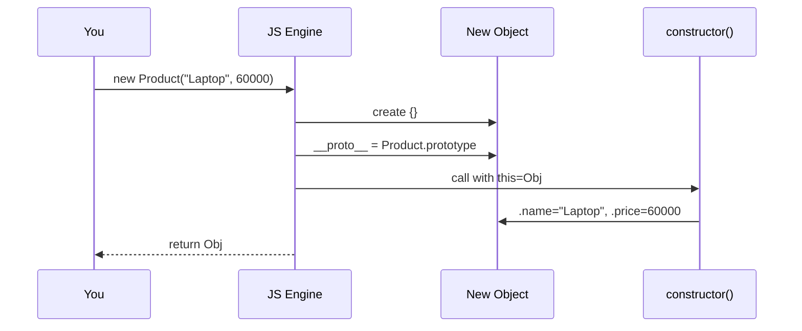

# 03 — Classes & Objects (with full internals) 📦

## The minimum class

```python
# 🐍 Python
class Product:
    pass                        # empty class is legal

p = Product()                   # create an object (instantiate)
p.name = "Mouse"                # attach data to the object
print(p.name)                   # Mouse
```

```js
// ⚡ JavaScript
class Product {}

const p = new Product();        // `new` is REQUIRED
p.name = "Mouse";
console.log(p.name);            // Mouse
```

---

## The constructor — giving objects their starting data

```python
# 🐍
class Product:
    def __init__(self, name, price):
        self.name = name        # self = THE object being built
        self.price = price

laptop = Product("Laptop", 60000)
```

```js
// ⚡
class Product {
  constructor(name, price) {
    this.name = name;           // this = THE object being built
    this.price = price;
  }
}

const laptop = new Product("Laptop", 60000);
```

### 🔬 `self` / `this` — what is it really?

It's just a **reference to the specific object** the method is working on.

```python
laptop = Product("Laptop", 60000)
mouse  = Product("Mouse", 1000)

# Inside laptop's __init__, self === laptop
# Inside mouse's __init__,  self === mouse
# `self.name` literally means "THIS object's name"
```

🏠 Analogy: `self` is the word "**my**". When a house's `paint()` method runs, `self.wall_color` = "**my** wall color" — not the neighbor's.

> ⚠️ Python gotcha: `self` is just a *convention* name — but NEVER rename it. And you must declare it as the first parameter (Python passes it automatically when you call `obj.method()`).

```python
class Product:
    def total_price(self, quantity):
        return self.price * quantity

laptop.total_price(2)
# Python secretly does: Product.total_price(laptop, 2)
#                          ↑ your object gets injected as `self`
```

### 🔬 What `new` does in JavaScript — the 4 steps

`new Product("Laptop", 60000)` is shorthand for:

```js
// Step 1: create empty object
const obj = {};

// Step 2: link its prototype to Product.prototype
Object.setPrototypeOf(obj, Product.prototype);

// Step 3: run constructor with `this` = obj
Product.call(obj, "Laptop", 60000);   // this.name = "Laptop" ...

// Step 4: return obj (unless constructor returns its own object)
```



### 🔬 What `Product(...)` does in Python — 2 steps

```python
laptop = Product("Laptop", 60000)
# Python actually calls:
# 1) obj = Product.__new__(Product)          → allocate empty object
# 2) Product.__init__(obj, "Laptop", 60000)  → fill it (self = obj)
# 3) return obj
```

`__new__` creates, `__init__` initializes. You almost never touch `__new__` (except in advanced cases — see file 09 and the `NormalizedEmail` example at the top of your `index.py`).

---

## 🏃 Full dry run

```python
class Product:
    currency = "INR"                          # class attribute (shared)

    def __init__(self, name, price):
        self.name = name                      # instance attribute
        self.price = price

    def total_price(self, quantity=1):
        return self.price * quantity

laptop = Product("Laptop", 60000)
print(laptop.total_price(2))
```

| Step | What happens | Memory after |
|------|--------------|--------------|
| `class Product:` | Python builds a class OBJECT named `Product` (classes are objects too!) | `Product` → class object |
| `currency = "INR"` | Stored in `Product.__dict__`, NOT on instances | `Product.__dict__ = {currency: "INR", ...}` |
| `Product("Laptop", 60000)` | `__new__` makes empty object → `__init__` fills it | `laptop` → `{name:"Laptop", price:60000}` |
| `laptop.total_price` | Python looks up `total_price`: not on laptop → found on `Product` → wraps it into a *bound method* | — |
| `total_price(2)` | Calls `Product.total_price(laptop, 2)` → `self.price` = 60000 → `60000*2` | returns `120000` |

### Attribute lookup order 🔬

When you write `laptop.currency`, Python checks **in order**:

```
1. laptop.__dict__        → instance's own data
2. Product.__dict__       → class data & methods
3. parent classes (MRO)   → inherited stuff
4. __getattr__ (if defined) → last resort
→ AttributeError if nothing found
```

```python
laptop.__dict__      # {'name': 'Laptop', 'price': 60000}
Product.__dict__     # mappingproxy({'currency':'INR', '__init__':..., 'total_price':...})
laptop.currency      # "INR" — found on the CLASS, not the instance
```

```js
// ⚡ same lookup, different machinery — the prototype chain
laptop.currency      // laptop → Product.prototype → Object.prototype → null
Object.getPrototypeOf(laptop) === Product.prototype   // true
```

---

## Class attributes vs instance attributes

```python
class Product:
    currency = "INR"              # CLASS attr — ONE copy, shared by all

    def __init__(self, name, price):
        self.name = name          # INSTANCE attr — each object has its OWN

laptop = Product("Laptop", 60000)
mouse = Product("Mouse", 1000)

Product.currency = "USD"          # change on the class...
print(laptop.currency, mouse.currency)   # USD USD — both see it!
```

```js
// ⚡ equivalent
class Product {
  static currency = "INR";        // static = lives on the class
  constructor(name, price) {
    this.name = name;             // instance field
    this.price = price;
  }
}
Product.currency = "USD";
```

> ⚠️ **Mutable class attribute trap (Python):**
> ```python
> class Cart:
>     items = []                  # shared by EVERY cart! 😱
> cart1, cart2 = Cart(), Cart()
> cart1.items.append("x")
> print(cart2.items)              # ['x'] — leaked into cart2!
> # FIX: always init mutable data in __init__: self.items = []
> ```

---

## Methods are just functions that live on the class

```python
class Product:
    def __init__(self, name, price):
        self.name = name
        self.price = price

    def describe(self):
        return f"{self.name} — ₹{self.price}"

laptop = Product("Laptop", 60000)

# These two are THE SAME call:
laptop.describe()                    # normal way — self injected
Product.describe(laptop)             # explicit way — proof of what Python does
```

```js
// ⚡ JS: method lives on Product.prototype (shared, not copied per object!)
const laptop = new Product("Laptop", 60000);
laptop.describe === Product.prototype.describe;   // true — ONE copy shared
laptop.hasOwnProperty("describe");                // false — it's on the prototype
```

**Memory picture:**

```
Python:                          JS:
┌─────────┐   __class__   ┌──────────┐    ┌─────────┐  __proto__  ┌───────────────────┐
│ laptop  │ ────────────► │ Product  │    │ laptop  │ ──────────► │ Product.prototype │
│ name    │               │ describe │    │ name    │             │ describe()        │
│ price   │               │ currency │    │ price   │             │ constructor       │
└─────────┘               └──────────┘    └─────────┘             └───────────────────┘
```

Both share **one copy** of each method — objects only store their own *data*. (In Python the method physically lives in `Product.__dict__`; in JS on `Product.prototype`. Same idea.)

---

## Modern syntax in classes ⚡

```js
class Product {
  // Class fields — declared directly (ES2022+), no need for this.x = x in ctor
  category = "electronics";
  #currency = "INR";                    // private field — see file 04

  // Default + destructured params
  constructor(name = "Item", { price = 0, stock = 0 } = {}) {
    this.name = name;
    this.price = price;
    this.stock = stock;
  }

  // Arrow FUNCTION FIELD — `this` permanently bound to the instance
  describe = () => `${this.name} — ₹${this.price}`;
  //    ↑ stored PER object (unlike prototype methods). Useful as callback.

  // Object spread — clone with overrides
  withDiscount(pct) {
    const clone = Object.create(Object.getPrototypeOf(this));
    return Object.assign(clone, { ...this, price: this.price * (1 - pct/100) });
  }
}

const p = new Product("Mouse", { price: 1000, stock: 50 });
console.log(p.describe());              // Mouse — ₹1000
```

```python
# 🐍 modern pythonic equivalent
from dataclasses import dataclass, field, replace

@dataclass                      # auto-writes __init__, __repr__, __eq__ for you!
class Product:
    name: str
    price: float
    stock: int = 0
    category: str = "electronics"
    tags: list = field(default_factory=list)   # safe mutable default

    def describe(self):
        return f"{self.name} — ₹{self.price}"

p = Product("Mouse", 1000, stock=50)
discounted = replace(p, price=p.price * 0.9)   # clone with override — like {...p, price}
```

`@dataclass` = Python's biggest OOP shortcut — the boilerplate `__init__` is generated for you. (More in file 09.)

---

## ✅ Quick check

1. `self`/`this` is ___? *(a reference to the current object)*
2. In JS, where do methods physically live? *(`Class.prototype`)*
3. In Python, `obj.m(2)` is rewritten internally as ___? *(`Class.m(obj, 2)`)*
4. Why is `items = []` as a class attribute dangerous? *(shared mutable state across all instances)*

➡️ **Next:** `04-encapsulation.md`
