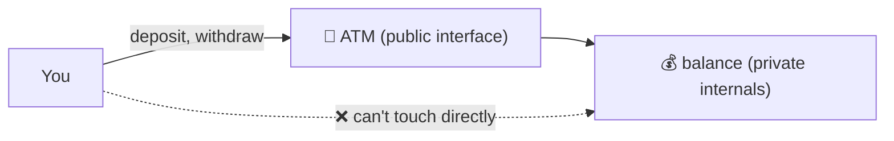
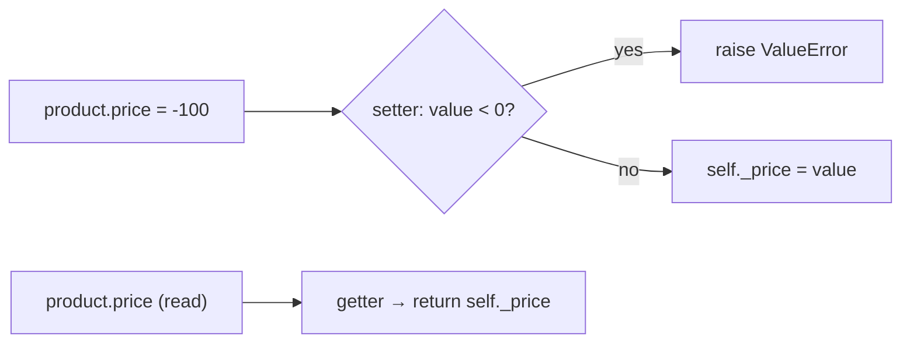

# 04 — Encapsulation: Protect Your Data 🔒

## The idea

> **Encapsulation = bundle data + methods together AND control who can touch the data.**

🏠 **Analogy — the ATM:**
Your bank balance is *private*. You can't open the ATM's code and type `balance = 999999`. You interact through controlled buttons: `withdraw()`, `deposit()`, `checkBalance()`. The machine *validates* every action.



---

## The problem: why not just let everything be public?

```python
class BankAccount:
    def __init__(self, balance):
        self.balance = balance          # public — anyone can do ANYTHING

acc = BankAccount(1000)
acc.balance = -99999999                 # 💥 bank is now bankrupt, nothing stopped it
```

We need a way to say: *"balance changes ONLY through my rules."*

---

## Level 0 — the underscore convention `_name`

```python
class Product:
    def __init__(self, name, price):
        self.name = name
        self._price = price     # single underscore = "please treat as private"
```

`_price` is a **social contract**, not a wall. Python won't stop anyone — it just signals *"internal, don't touch."*

```js
// ⚡ same convention
class Car {
  constructor() {
    this._discount = 15;        // "please don't touch" — but JS won't stop you either
  }
}
```

(This is exactly what your `Cars` class used — `obj2._discount = 26` worked because `_` is only a hint.)

---

## Level 1 — real protection

### ⚡ JavaScript: `#` truly private fields

```js
class BankAccount {
  #balance = 0;                        // HARD private — invisible outside

  constructor(owner) {
    this.owner = owner;                // public
  }

  deposit(amount) {
    if (amount <= 0) throw new Error("Deposit must be positive");
    this.#balance += amount;
    return this.#balance;
  }

  get balance() {                      // read-only window into private state
    return this.#balance;
  }
}

const acc = new BankAccount("Shiv");
acc.deposit(1000);
console.log(acc.balance);              // 1000 — via getter
acc.#balance;                          // ❌ SyntaxError — parse-time refusal!
acc.balance = 5;                       // ❌ TypeError — no setter defined
```

🔬 `#balance` is private at the **language level** — it's not a property on the object at all. It's stored in an internal slot; `obj.#x` outside the class is rejected at *parse time* (SyntaxError, not runtime). DevTools, `Object.keys`, `JSON.stringify` — none can see it.

### 🐍 Python: `__name` name mangling

```python
class BankAccount:
    def __init__(self, owner):
        self.owner = owner
        self.__balance = 0                    # "private" by convention+obfuscation

    def deposit(self, amount):
        if amount <= 0:
            raise ValueError("Deposit must be positive")
        self.__balance += amount
        return self.__balance

    @property
    def balance(self):
        return self.__balance

acc = BankAccount("Shiv")
acc.deposit(1000)
acc.__balance          # ❌ AttributeError
```

🔬 **Internals — name mangling:** inside the class, Python *textually rewrites* `__balance` → `_BankAccount__balance`. It's not true privacy:

```python
acc._BankAccount__balance   # 1000 — reachable if you know the trick 😅
acc.__dict__                # {'owner':'Shiv', '_BankAccount__balance':1000}
```

Python's philosophy: *"we're all consenting adults."* `__` prevents **accidental** access and name collisions in subclasses — it's a strong fence, not a bank vault. JS `#` fields are the actual vault.

### 🆚 Privacy comparison

| Mechanism | Lang | Strength | Reachable? |
|-----------|------|----------|------------|
| `_name` | both | convention only | yes, trivially |
| `__name` (mangling) | 🐍 | obfuscation | yes, via `_Class__name` |
| `#name` | ⚡ | **true privacy** | no — SyntaxError |
| `WeakMap` closure trick | ⚡ | true (pre-`#` hack) | no |

---

## Level 2 — Getters & Setters: controlled access

The goal: `obj.price` *looks like* attribute access but *runs code* behind the scenes.

### 🐍 Python: `@property`

```python
class Product:
    def __init__(self, name, price):
        self.name = name
        self.price = price          # goes THROUGH the setter! validation works in ctor too

    @property                        # getter — turns method into attribute-like access
    def price(self):
        return self._price

    @price.setter                    # setter — runs on assignment
    def price(self, value):
        if value < 0:
            raise ValueError("Price cannot be negative")
        self._price = value          # real storage lives in _price

product = Product("Mouse", 1000)
product.price = 1500                 # setter runs ✔
print(product.price)                 # getter runs → 1500
product.price = -100                 # ValueError — this is the error you saw in your terminal!
```

🔬 **How `@property` works internally:** `property` is a **descriptor** — an object with `__get__`/`__set__` methods that Python calls automatically during attribute lookup. `product.price` → Python finds `price` in `Product.__dict__` → sees it's a descriptor → calls its `__get__` → your getter runs. (Deep dive in file 09.)

Why `_price` inside? If the setter did `self.price = value`, it would **call itself** → infinite recursion → `RecursionError`. The underscore attribute is the real storage; `price` is the guarded doorway.



Computed (read-only) properties:

```python
@property
def price_with_gst(self):
    return self._price * 1.18        # computed on the fly, never stored
```

### ⚡ JavaScript: `get` / `set`

```js
class Product {
  #price = 0;

  constructor(name, price) {
    this.name = name;
    this.price = price;              // goes through the setter
  }

  get price() {                      // obj.price — looks like a property
    return this.#price;
  }

  set price(value) {                 // obj.price = x — runs validation
    if (value < 0) throw new Error("Price cannot be negative");
    this.#price = value;
  }

  get priceWithGST() {
    return this.#price * 1.18;
  }
}

const p = new Product("Mouse", 1000);
p.price = -5;          // ❌ Error
p.price = 1500;        // setter ✔
console.log(p.priceWithGST);  // 1770 — computed, not stored
```

### Plain getter/setter METHODS (older style, still used)

```js
getDiscount()  { return this._discount; }
setDiscount(d) { if (d < 0) throw ...; this._discount = d; }
```

```python
def get_discount(self): ...
def set_discount(self, d): ...
```

🆚 Property-style (`obj.price`) is preferred in both languages — callers can't tell it's guarded, and you can *start* with a plain attribute and add validation later **without changing the interface**. That's encapsulation's killer feature.

---

## The exact bug you asked about 🔍

```js
class Product {
  #currency = "INR";
  constructor(name, price) {
    this.currency = this.#currency;   // ← creates a SEPARATE public property!
  }
}
laptop.currency = "USD";   // mutates the public COPY — #currency still "INR"
```

`this.currency` is a **new public field** that only copied the private *value*. Two boxes, not one:

```
laptop {
  currency: "USD"     ← you changed this (public copy)
  #currency: "INR"    ← still this, inside the private slot (invisible)
}
```

Fix — expose via getter, delete the public copy:

```js
class Product {
  #currency = "INR";
  get currency() { return this.#currency; }
}
```

---

## Private METHODS too

```python
class Order:
    def checkout(self):
        self.__apply_fraud_check()          # internal helper
        self.__charge_card()

    def __apply_fraud_check(self):          # mangled → _Order__apply_fraud_check
        print("checking...")
    def __charge_card(self): ...
```

```js
class Order {
  checkout() {
    this.#fraudCheck();
    this.#chargeCard();
  }
  #fraudCheck() { console.log("checking..."); }   // truly private
  #chargeCard() { /* ... */ }
}
```

---

## Get/set on child classes & mangling gotcha 🐍

```python
class Parent:
    def __init__(self): self.__secret = 42

class Child(Parent):
    def reveal(self):
        return self.__secret          # looks for _Child__secret → AttributeError!
        # fix: self._Parent__secret  — mangling is CLASS-scoped
```

That's another reason `__` exists: `Parent.__secret` and `Child.__secret` mangle to *different* names → no accidental collisions between a parent's and child's "private" attributes.

---

## ✅ Checklist

| You want | Python 🐍 | JavaScript ⚡ |
|----------|-----------|---------------|
| "Don't touch" hint | `_attr` | `_attr` |
| Enforced privacy | `__attr` (mangled — weak) | `#field` (strong) |
| Read-only attribute | `@property` (no setter) | `get x() {}` (no setter) |
| Validated write | `@x.setter` | `set x(v) {}` |
| Private method | `def __m(self)` | `#m() {}` |
| Private static/class helper | `@staticmethod def __h()` | `static #h() {}` |

➡️ **Next:** `05-methods-deep-dive.md`
