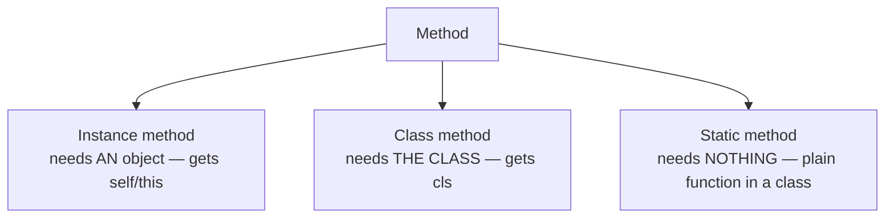
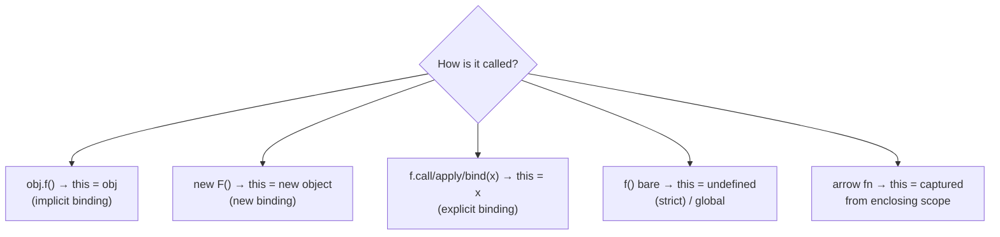

# 05 — Methods Deep Dive: instance / class / static 🔬

## The three kinds of methods



| Type | Auto-receives | Use for | Example |
|------|---------------|---------|---------|
| Instance | `self` / `this` — the object | work on that object's data | `laptop.total_price()` |
| Class | `cls` — the class itself | alternative constructors, class-level data | `Product.from_dict(data)` |
| Static | nothing | utility that belongs *conceptually* to the class | `Product.is_valid_price(x)` |

🏠 **Analogy (McDonald's):**
- Instance method = a *specific restaurant* serving your order (`branch12.serve()`)
- Class method = *corporate HQ* opening a new branch (`McDonalds.openBranch()`)
- Static method = a *rule book* that exists at HQ, doesn't need any branch (`McDonalds.is_valid_order(item)`)

---

## 🐍 Python — all three side by side

```python
class Product:
    tax_rate = 0.18                            # class attribute

    def __init__(self, name, price):
        self.name = name
        self.price = price

    # 1) INSTANCE — receives the object as `self`
    def total_price(self, quantity=1):
        return self.price * quantity * (1 + Product.tax_rate)

    # 2) CLASS — receives the CLASS as `cls`
    @classmethod
    def from_dict(cls, data):                  # "alternative constructor"
        return cls(data["name"], data["price"])   # cls(...) == Product(...)

    @classmethod
    def set_tax(cls, rate):                    # modifies class-level data
        cls.tax_rate = rate

    # 3) STATIC — receives nothing
    @staticmethod
    def is_valid_price(value):
        return isinstance(value, (int, float)) and value >= 0
```

### Usage

```python
product = Product.from_dict({"name": "Keyboard", "price": 2500})
print(product.total_price(2))            # 5900.0
print(Product.is_valid_price(10))        # True
Product.set_tax(0.12)                    # affects ALL products
```

### 🏃 Dry run — what `product.total_price(2)` does

```
product.total_price          → lookup: not in product.__dict__
                             → found in Product.__dict__ (a function)
                             → BINDS it: creates bound method wrapping (Product.total_price, product)
(2)                          → calls Product.total_price(product, 2)
self.price * quantity ...    → 2500 * 2 * 1.18 → 5900
```

```python
Product.total_price          # <function>  — plain function
product.total_price          # <bound method> — function + object glued together
```

🔬 A **bound method** = `function` + pre-filled `self`. Python's descriptor protocol does this automatically on attribute access (details in file 09).

### Why classmethods as constructors?

```python
class User:
    def __init__(self, name, email):
        self.name, self.email = name, email

    @classmethod
    def from_string(cls, s):                  # "shiv,shiv@x.com" → User
        name, email = s.split(",")
        return cls(name, email)

    @classmethod
    def guest(cls):                           # named constructor
        return cls("Guest", "guest@x.com")

User.from_string("shiv,shiv@x.com")
User.guest()
```

The killer detail: `cls(...)` not `User(...)` — so if `Admin(User)` calls `Admin.from_string(...)`, you get an **Admin**, not a User. `cls` = whatever class it was called *on*.

### ⚠️ Your bug from index.py

```python
def total_price():            # no self!
# calling laptop.total_price() → Python injects laptop → TypeError:
# total_price() takes 0 positional arguments but 1 was given
```

Every instance method's first parameter IS the object — forget `self` and Python hands the object to... nothing.

---

## ⚡ JavaScript — instance / static / (fields)

```js
class Product {
  static taxRate = 0.18;                   // class-level data

  constructor(name, price) {
    this.name = name;
    this.price = price;
  }

  // INSTANCE method — `this` = calling object
  totalPrice(quantity = 1) {
    return this.price * quantity * (1 + Product.taxRate);
  }

  // STATIC method — called on the CLASS, `this` = the class
  static fromDict({ name, price }) {       // destructuring from file 01!
    return new Product(name, price);
  }

  static isValidPrice(v) {
    return typeof v === "number" && v >= 0;
  }

  // private static helper
  static #round(x) { return Math.round(x * 100) / 100; }
}

const kb = Product.fromDict({ name: "Keyboard", price: 2500 });
kb.totalPrice(2);              // 5900
Product.isValidPrice(10);      // true
kb.isValidPrice(10);           // ❌ TypeError — statics live on the class, not instances
```

🔬 **JS has no `@classmethod`** — `static` covers both roles. Inside `static fromDict`, `this` **is the class**, so `new this(name, price)` is the JS version of `cls(...)`:

```js
static fromDict({ name, price }) {
  return new this(name, price);   // subclass calls → builds the SUBclass ✅ (like cls)
}
```

---

## 🔬 `this` in JS — the 4 binding rules (read this twice)

`this` is decided by **HOW the function is called**, not where it's defined.



```js
const product = {
  name: "Laptop",
  describe() { return this.name; }
};

product.describe();              // "Laptop" — implicit binding

const stolen = product.describe;
stolen();                        // undefined — LOST its binding! (strict mode)

// Fixes for lost `this`:
const bound = product.describe.bind(product);
bound();                         // "Laptop" — bind() glues this permanently

// Or arrow field in a class — `this` captured at birth
class P {
  name = "Mouse";
  describe = () => this.name;    // arrow: `this` locked to the instance
}
const p = new P();
const ref = p.describe;
ref();                           // "Mouse" — still works!
```

🆚 Python's `self` never has this problem — `laptop.total_price` auto-binds on every access. JS `this` is determined at *call time*, which is why `.bind()` and arrow fields exist.

---

## Instance method vs function — are they the same object?

```python
product.total_price            # NEW bound-method object each access, but…
product.total_price.__func__ is Product.total_price   # True — same underlying fn
```

```js
const a = product.totalPrice;
const b = product.totalPrice;
a === b                                  // true — same function on prototype
product.totalPrice === Product.prototype.totalPrice   // true
```

---

## Class-method alternative in JS: factory functions (no class at all)

```js
const Product = {
  taxRate: 0.18,
  fromDict: ({ name, price }) => ({ name, price, taxRate: Product.taxRate }),
};
```

Or with closures — true privacy without `#`:

```js
function createAccount(initial) {
  let balance = initial;              // closure variable — 100% private
  return {
    deposit: amt => (balance += amt),
    getBalance: () => balance,
  };
}
const acc = createAccount(100);
acc.balance;          // undefined — not a property at all
acc.getBalance();     // 100
```

This "module/factory pattern" is OOP without `class` — worth knowing it exists.

---

## Decorators = method wrappers 🐍

You'll see `@property`, `@classmethod`, `@staticmethod` — a decorator is just `fn = decorator(fn)`:

```python
# @staticmethod
# def f(x): ...
# means: f = staticmethod(f)   — literally a function call wrapping f
```

You can write your own:

```python
import time, functools

def timed(fn):
    @functools.wraps(fn)
    def wrapper(*args, **kwargs):            # *args/**kwargs from file 01
        t = time.perf_counter()
        result = fn(*args, **kwargs)
        print(f"{fn.__name__} took {time.perf_counter()-t:.4f}s")
        return result
    return wrapper

class Report:
    @timed
    def generate(self):
        time.sleep(0.1)
        return "done"

Report().generate()   # generate took 0.1012s
```

---

## ✅ Cheat sheet

| Need | Python 🐍 | JavaScript ⚡ |
|------|-----------|---------------|
| Object method | `def m(self)` | `m() {}` |
| Alternative constructor | `@classmethod def from_x(cls)` | `static fromX() { return new this() }` |
| Utility on class | `@staticmethod` | `static m() {}` |
| Class-level data | `x = 1` in class body | `static x = 1` |
| Bound-to-instance fn | automatic (`self`) | `m = () => ...` field or `.bind(this)` |
| Private method | `def __m(self)` | `#m() {}` / `static #m()` |

➡️ **Next:** `06-inheritance.md`
