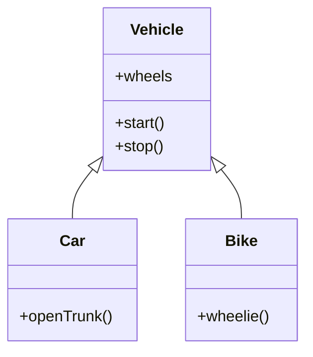
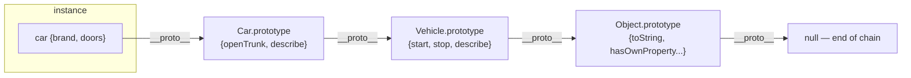

# 06 — Inheritance: Reuse & Extend 🧬

## The idea

> **Inheritance = a child class automatically gets everything the parent has, then can add or change parts of it.**

🏠 **Analogy:** `Vehicle` knows how to `start()`, `stop()`, has `wheels`. `Car`, `Bike`, `Truck` inherit all of it for free — then each adds its own specialty (a `Car` has `openTrunk()`, a `Bike` has `wheelie()`).



The **IS-A** test: *"Car IS-A Vehicle"* ✅ → inheritance makes sense.
*"Car IS-A Engine"* ❌ → that's HAS-A → composition (file 10).

---

## Basic inheritance

### 🐍 Python

```python
class Vehicle:
    def __init__(self, brand):
        self.brand = brand

    def start(self):
        return f"{self.brand} engine started"

class Car(Vehicle):                       # Car inherits Vehicle
    def open_trunk(self):
        return "trunk open"

car = Car("Tata")
car.start()          # "Tata engine started" — inherited free ✅
car.open_trunk()     # "trunk open"        — its own
```

### ⚡ JavaScript

```js
class Vehicle {
  constructor(brand) {
    this.brand = brand;
  }
  start() {
    return `${this.brand} engine started`;
  }
}

class Car extends Vehicle {
  openTrunk() {
    return "trunk open";
  }
}

const car = new Car("Tata");
car.start();        // inherited
car.openTrunk();    // own
```

---

## `super` — calling the parent's version

When the child needs the parent's constructor/behavior **plus** its own:

```python
# 🐍
class Vehicle:
    def __init__(self, brand, wheels):
        self.brand = brand
        self.wheels = wheels

    def describe(self):
        return f"{self.brand} with {self.wheels} wheels"

class Car(Vehicle):
    def __init__(self, brand, doors):
        super().__init__(brand, wheels=4)     # run parent's __init__ first
        self.doors = doors                     # then add child's own data

    def describe(self):                        # override
        return f"{super().describe()}, {self.doors} doors"   # reuse parent!

car = Car("Tata", 4)
car.describe()   # "Tata with 4 wheels, 4 doors"
```

```js
// ⚡
class Car extends Vehicle {
  constructor(brand, doors) {
    super(brand, 4);          // MUST call super() before using `this`!
    this.doors = doors;
  }
  describe() {
    return `${super.describe()}, ${this.doors} doors`;
  }
}
```

> ⚠️ **JS rule:** in a derived constructor you **must** call `super()` before touching `this` — the parent is what *creates* `this` (conceptually). Using `this` first → `ReferenceError`.

### 🏃 Dry run — `Car("Tata", 4)` in Python

```
1. Car.__init__("Tata", 4) called
2.   super().__init__("Tata", wheels=4)
     → Vehicle.__init__ runs → self.brand="Tata", self.wheels=4
3.   self.doors = 4
4. car = {brand:"Tata", wheels:4, doors:4}
```

🔬 `super()` in Python isn't the parent object — it's a **proxy that continues the MRO search** (next section). In a simple chain it *is* the parent; with multiple inheritance it becomes the "next in line."

---

## 🔬 How lookup actually works

### Python: Method Resolution Order (MRO)

`obj.method()` → Python walks `Class.__mro__` left to right:

```python
class A: 
    def who(self): return "A"
class B(A):
    pass
class C(B):
    pass

C.__mro__   # (C, B, A, object)
# C.__mro__  ===  C.mro()  — the exact search order
```

`object` is the ultimate parent of everything in Python — `__init__`, `__str__`, `__eq__` all come from it.

### JavaScript: the prototype chain

`obj.method()` → walks `__proto__` links until `null`:

```js
car → Car.prototype → Vehicle.prototype → Object.prototype → null
```

```js
Object.getPrototypeOf(car) === Car.prototype           // true
Object.getPrototypeOf(Car.prototype) === Vehicle.prototype  // true
car instanceof Car        // true  — chain check
car instanceof Vehicle    // true
car instanceof Object     // true
```



🆚 **Key difference:**
- **Python:** methods live *on the class objects*; lookup via MRO list (computed once, linearized).
- **JS:** `class` is sugar — methods live on `*.prototype` objects; lookup is a *live chain walk* (`__proto__` links). `Car.prototype` is literally an object you can modify at runtime.

```js
// Monkey-patching the prototype — affects ALL instances, even existing ones!
Vehicle.prototype.honk = function() { return "beep!"; };
car.honk();   // works — car was made BEFORE honk existed 😮
```

Python equivalent (works too, but rarer to do):

```python
Vehicle.honk = lambda self: "beep!"
car.honk()    # works
```

---

## Method overriding — child replaces parent

```python
class Notifier:
    def send(self, msg):
        raise NotImplementedError("subclasses must implement send")

class EmailNotifier(Notifier):
    def send(self, msg):
        return f"📧 Email: {msg}"

class SMSNotifier(Notifier):
    def send(self, msg):
        return f"📱 SMS: {msg}"
```

Child's version **wins** — Python finds `send` on `EmailNotifier` first in the MRO and stops looking.

```js
class EmailNotifier extends Notifier {
  send(msg) { return `📧 Email: ${msg}`; }
}
```

---

## 🔺 Multiple inheritance & the Diamond Problem

```python
class A:
    def who(self): return "A"
class B(A):
    def who(self): return "B"
class C(A):
    def who(self): return "C"
class D(B, C):          # multiple parents!
    pass

D().who()               # "B" — why?
D.__mro__               # (D, B, C, A, object)
```

```
        A
       / \
      B   C
       \ /
        D          ← "diamond"
```

🔬 Python solves it with the **C3 linearization** algorithm: `D(B,C)` → search order = D → B → C → A → object. Each class appears once; leftmost parent wins first. Your `index.py` demonstrated this:

```python
class Notifier(EmailNotifier, SMSNotifier): pass
Notifier().send()          # "Sending email" — EmailNotifier is FIRST in MRO
Notifier.__mro__           # (Notifier, EmailNotifier, SMSNotifier, object)
```

### Cooperative `super()` in diamonds

```python
class A:
    def greet(self):
        print("A")
        super().greet()          # keeps the chain going

class B(A):
    def greet(self):
        print("B")
        super().greet()

class C(A):
    def greet(self):
        print("C")
        super().greet()

class D(B, C): pass

D().greet()
# B → C → A → then object.greet() → AttributeError (object has no greet)
```

Prints `B`, `C`, `A` — `super()` from B goes to **C** (next in *D's* MRO, not B's parent!). This is "cooperative multiple inheritance": every class passes the baton to the *next in line*.

> ⚠️ JS has **no multiple inheritance** — `class X extends A, B` is a syntax error. JS uses **mixins** instead (file 10).

---

## `isinstance` / `isinstance` checks

```python
isinstance(car, Car)        # True
isinstance(car, Vehicle)    # True — child IS-A parent
issubclass(Car, Vehicle)    # True — class-level check
type(car) is Car            # True — exact type only
```

```js
car instanceof Car          // true
car instanceof Vehicle      // true
car.constructor === Car     // true (exact-ish)
```

⚠️ Prefer `isinstance` over `type(x) is T` — it respects inheritance.

---

## Inheriting built-ins (advanced preview)

```python
# Your commented-out code at top of index.py!
class NormalizedEmail(str):
    def __new__(cls, value):                       # str is IMMUTABLE —
        return super().__new__(cls, value.strip().upper())
        # can't change it in __init__ (object already built)
        # __new__ intercepts CREATION itself

email = NormalizedEmail("  shiv@EXAMPLE.COM  ")
print(email)                # SHIV@EXAMPLE.COM — note: upper() → SHIV@...
isinstance(email, str)      # True — it IS a str, plus normalization baked in
```

🔬 For immutable types (`str`, `int`, `tuple`), `__init__` is too late — the value is fixed at `__new__`. That's why you override `__new__` here. (More in file 09.)

```js
// ⚡ extending built-ins
class FancyArray extends Array {
  first() { return this[0]; }
  shuffle() { return this.sort(() => Math.random() - 0.5); }
}
const arr = FancyArray.from([3, 1, 2]);
arr.first();   // 3
```

---

## Inheritance rules of thumb

✅ **Good use:**
- Genuine IS-A relationships (`Admin IS-A User`)
- Shared base behavior in frameworks (`class MyView(BaseView)`)
- Abstract base classes (file 08)

❌ **Over-use traps:**
- Deep chains (`A→B→C→D→E`) — change at top breaks everything below (fragile base class)
- Forcing inheritance just to reuse a few functions → use composition
- `Square extends Rectangle` — breaks setters (Liskov violation, file 10)

---

## ✅ Quick check

1. `super().__init__()` in Python — what does `super()` actually return? *(a proxy following the MRO, not literally "the parent")*
2. `D(B, C)` where both B, C define `who()` — who wins? *(B — leftmost in MRO)*
3. In JS, where does `car.start` resolve physically? *(walks `__proto__` chain to `Vehicle.prototype`)*
4. Why must JS constructors call `super()` before `this`? *(`this` is uninitialized until the parent constructor runs)*

➡️ **Next:** `07-polymorphism.md`
