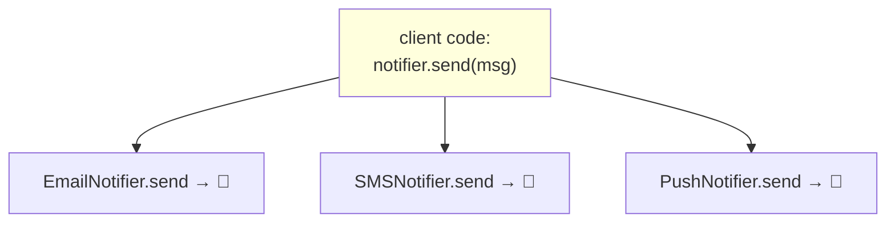

# 07 — Polymorphism: One Name, Many Behaviors 🎭

## The idea

> **Polymorphism ("many forms") = same method name, different behavior depending on the object.**

🏠 **Analogy:** the word "**drive**" — a taxi driver, bus driver, and truck driver all `drive()`, but each does it differently. You say "drive me to the airport" without caring WHICH vehicle shows up.



The client calls `send()`. It doesn't know or care which notifier it got. **That decoupling is the whole point.**

---

## The problem it solves

### Without polymorphism — `if/elif` soup 🍜

```python
def notify(notifier_type, msg):
    if notifier_type == "email":
        print(f"Email: {msg}")
    elif notifier_type == "sms":
        print(f"SMS: {msg}")
    elif notifier_type == "push":       # add new type → EDIT this function
        print(f"Push: {msg}")
    # ... 20 more elifs. Fragile, and every caller repeats this logic.
```

### With polymorphism — each class owns its behavior

```python
class EmailNotifier:
    def send(self, msg):
        return f"📧 Email: {msg}"

class SMSNotifier:
    def send(self, msg):
        return f"📱 SMS: {msg}"

class PushNotifier:
    def send(self, msg):
        return f"🔔 Push: {msg}"

# ONE generic function — works with ANY notifier, even ones written next year
def notify_all(notifiers, msg):
    return [n.send(msg) for n in notifiers]   # comprehension from file 01!

notify_all([EmailNotifier(), SMSNotifier()], "Server down!")
# ['📧 Email: Server down!', '📱 SMS: Server down!']
```

Add `SlackNotifier` tomorrow → `notify_all` doesn't change a single line. ✅

```js
// ⚡ same thing
const notifyAll = (notifiers, msg) => notifiers.map(n => n.send(msg));

notifyAll([new EmailNotifier(), new SMSNotifier()], "Server down!");
```

🔬 **Internals:** `n.send(msg)` resolves `send` on the *actual object's* class at runtime (Python MRO / JS prototype chain — file 06). That's **dynamic dispatch**: the method called is decided by the object's runtime type, not the variable's "expected" type.

---

## Duck typing 🦆

> **"If it walks like a duck and quacks like a duck — it's a duck."**

Python & JS don't check the class — they check whether `.send()` *exists*.

```python
class Pigeon:
    def send(self, msg):                     # no Notifier parent at all!
        return f"🕊️ Pigeon delivers: {msg}"

notify_all([Pigeon()], "hello")   # works! Has .send() → it's a notifier ✅
```

```js
const pigeon = { send: msg => `🕊️ ${msg}` };   // not even a class!
notifyAll([pigeon], "hello");                  // works
```

🆚 In Java/C++ you'd *need* a shared interface. In Python/JS, structural similarity is enough — **"does it have the method?"** beats **"is it the right class?"**

Python's lenient check:

```python
if hasattr(obj, "send"):        # duck-check
    obj.send(msg)
```

---

## Method overriding — the mechanism underneath

We saw it in file 06: child defines same-named method → found first in MRO/prototype chain → wins.

```python
class Shape:
    def area(self):
        raise NotImplementedError

class Circle(Shape):
    def __init__(self, r): self.r = r
    def area(self): return 3.14159 * self.r ** 2

class Square(Shape):
    def __init__(self, s): self.s = s
    def area(self): return self.s ** 2

# polymorphic call — one loop, two different formulas
for shape in [Circle(2), Square(3)]:
    print(shape.area())         # 12.57, 9
```

```js
class Circle extends Shape {
  constructor(r) { super(); this.r = r; }
  area() { return Math.PI * this.r ** 2; }
}
```

---

## Operator overloading — polymorphism for `+`, `==`, `<` 🐍

In Python, `a + b` literally calls `a.__add__(b)` internally. Define dunder methods → your objects work with built-in operators and functions.

```python
class Money:
    def __init__(self, amount, currency="INR"):
        self.amount = amount
        self.currency = currency

    def __add__(self, other):                       # m1 + m2
        if self.currency != other.currency:
            raise ValueError("Can't mix currencies")
        return Money(self.amount + other.amount, self.currency)

    def __eq__(self, other):                        # m1 == m2
        return (self.amount, self.currency) == (other.amount, other.currency)

    def __lt__(self, other):                        # m1 < m2
        return self.amount < other.amount

    def __repr__(self):                             # print(m) / debugging
        return f"Money({self.amount}, '{self.currency}')"

    def __str__(self):                              # str(m) — human readable
        return f"₹{self.amount}"

    def __len__(self):                              # len(m) — silly but legal
        return len(str(self.amount))

m1, m2 = Money(500), Money(300)
print(m1 + m2)          # Money(800, 'INR')   → __add__ + __repr__
print(str(m1))          # ₹500                → __str__
print(m1 == Money(500)) # True                → __eq__
print(sorted([m2, m1])) # [₹300, ₹500]        → __lt__ powers sort!
```

🔬 **Internals — how `m1 + m2` runs:**
```
m1 + m2
→ type(m1).__add__(m1, m2)      found? run it
→ else type(m2).__radd__(m2, m1)  (reflected — "maybe the RIGHT operand knows how")
→ else TypeError: unsupported operand
```

### The most useful dunders

| You write | Python calls | Purpose |
|-----------|--------------|---------|
| `obj(x)` | `__call__` | make objects callable like functions |
| `obj[i]` | `__getitem__` / `__setitem__` | indexable objects |
| `len(obj)` | `__len__` | length |
| `x in obj` | `__contains__` | membership |
| `for x in obj` | `__iter__` / `__next__` | iteration |
| `obj.attr` | `__getattr__` / `__setattr__` | attribute access hooks |
| `with obj:` | `__enter__` / `__exit__` | context managers |
| `repr(obj)` | `__repr__` | dev-facing string |
| `str(obj)` | `__str__` | user-facing string |
| `obj == y` | `__eq__` | equality |
| `hash(obj)` | `__hash__` | dict/set keys |

```python
class Cart:
    def __init__(self):
        self._items = []

    def add(self, item):
        self._items.append(item)
        return self                       # enables chaining: cart.add(a).add(b)

    def __len__(self):  return len(self._items)
    def __getitem__(self, i):  return self._items[i]
    def __contains__(self, item):  return item in self._items
    def __iter__(self):  return iter(self._items)

cart = Cart().add("laptop").add("mouse")
len(cart)            # 2
cart[0]              # "laptop"
"mouse" in cart      # True
[x for x in cart]    # ['laptop','mouse'] — iterable!
```

### ⚡ JS equivalents (limited operator overloading)

JS **can't** overload `+`/`==` — but has hooks:

```js
class Money {
  constructor(amount) { this.amount = amount; }

  toString()  { return `₹${this.amount}`; }            // `${m}`, String(m)
  valueOf()   { return this.amount; }                  // +m, m1 + m2 → numbers!
  toJSON()    { return { amount: this.amount }; }      // JSON.stringify(m)

  // Symbol hooks — the real "dunder" equivalents
  [Symbol.iterator]() { /* make for..of work */ }
  static [Symbol.hasInstance](x) { return x?.amount != null; }
}

const m = new Money(500);
`${m}`              // "₹500"        → toString
m + new Money(300)  // 800           → valueOf both sides!
JSON.stringify(m)   // {"amount":500} → toJSON
```

---

## Ad-hoc polymorphism in JS: same name, different shapes

```js
class Renderer {
  render(shape) {
    return shape.render();      // polymorphic dispatch
  }
}

const shapes = [
  { render: () => "▭ rect" },
  { render: () => "◯ circle" },
];
shapes.map(s => s.render());   // each renders its own way
```

---

## Function overloading? 

🐍 **Python & ⚡ JS have NO true overloading** (same name, different signatures) — last definition wins:

```python
class Calc:
    def add(self, a, b): return a + b
    def add(self, a, b, c): return a + b + c   # erases the first add!
```

Workarounds — default args & dispatch:

```python
def add(self, a, b, c=0): return a + b + c       # default args

def describe(self, x):
    if isinstance(x, int): ...                    # manual dispatch
    elif isinstance(x, str): ...

from functools import singledispatchmethod        # real overloading!

class Formatter:
    @singledispatchmethod
    def show(self, x): return str(x)

    @show.register
    def _(self, x: int): return f"int: {x:,}"

    @show.register
    def _(self, x: list): return f"list of {len(x)}"
```

```js
// ⚡ JS: dispatch manually
describe(x) {
  if (typeof x === "number") return `num ${x}`;
  if (Array.isArray(x)) return `array[${x.length}]`;
}
// or: rest params
add(...nums) { return nums.reduce((a,b)=>a+b, 0); }
```

---

## ✅ Recap

| Concept | Meaning |
|---------|---------|
| Polymorphism | Same call, different behavior per object type |
| Dynamic dispatch | Runtime picks the method via MRO/prototype chain |
| Duck typing | Capability (`has .send()`) > ancestry (`is Notifier`) |
| Operator overloading | 🐍 dunders (`__add__`...); ⚡ `toString`/`valueOf`/Symbols |
| Overloading | Neither language supports it natively — use defaults/dispatch/`singledispatchmethod` |

➡️ **Next:** `08-abstraction.md`
