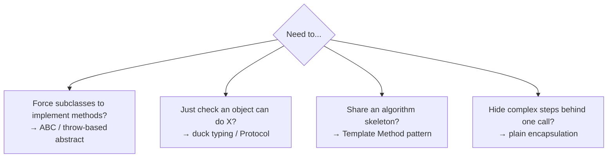

# 08 — Abstraction: Simple Interface, Hidden Complexity 🎛️

## The idea

> **Abstraction = show users a simple "what", hide the messy "how".**

🏠 **Analogy — driving a car:**
- You use: steering wheel, pedals, gear → **the interface (what)**
- Hidden: fuel injection, gear ratios, ABS logic → **the implementation (how)**

You don't need to be a mechanic to drive. Abstraction = the dashboard.

---

## Abstraction vs Encapsulation — the classic confusion 🆚

| | Abstraction | Encapsulation |
|---|---|---|
| Question | "What can it do?" | "Who can touch it?" |
| Mechanism | Simple public interface over complex internals | Private fields + getters/setters |
| Analogy | Car dashboard | Locked bonnet over the engine |
| Code tool | Abstract classes, interfaces, clean method names | `#`, `__`, `@property` |

They work together: the dashboard (abstraction) is *achieved by* hiding internals (encapsulation).

```python
class CoffeeMachine:
    def brew(self):                     # ABSTRACTION — one simple button
        self.__heat_water()             # ENCAPSULATION — messy steps hidden
        self.__grind_beans()
        self.__pressure_extract()

    def __heat_water(self): ...
    def __grind_beans(self): ...
    def __pressure_extract(self): ...

machine.brew()    # caller just presses "brew" — complexity invisible
```

---

## Abstract Base Classes — "you MUST implement this"

An abstract class is a **half-built blueprint**: it defines *what* subclasses must provide, but can't be instantiated itself.

🏠 Analogy: a government's building code — "every building MUST have a fire exit." It doesn't tell you *how* to build it, but no building gets approved without one.

### 🐍 Python: `abc` module

```python
from abc import ABC, abstractmethod

class PaymentMethod(ABC):                    # can't create PaymentMethod() directly

    @abstractmethod
    def pay(self, amount):                   # subclasses MUST implement this
        """Charge the given amount."""
        ...

    @abstractmethod
    def refund(self, amount):
        ...

    # Concrete methods CAN exist too — shared behavior for all children
    def receipt(self, amount):
        return f"Receipt for ₹{amount} via {type(self).__name__}"

class UPI(PaymentMethod):
    def pay(self, amount): return f"Paid ₹{amount} via UPI"
    def refund(self, amount): return f"Refunded ₹{amount} to UPI"

class CreditCard(PaymentMethod):
    def pay(self, amount): return f"Charged ₹{amount} on card"
    def refund(self, amount): return f"Reversed ₹{amount} on card"
```

```python
PaymentMethod()       # ❌ TypeError: Can't instantiate abstract class
                      #     PaymentMethod with abstract methods pay, refund

class Incomplete(PaymentMethod):
    def pay(self, a): return "ok"
    # forgot refund!

Incomplete()          # ❌ TypeError — can't instantiate until ALL abstracts implemented ✅
```

🔬 **Internals:** `ABC`'s metaclass (`ABCMeta`) collects every method marked `@abstractmethod` into `cls.__abstractmethods__`. Instantiating while that frozenset is non-empty → TypeError. `__abstractmethods__` is checked at *instantiation*, not class definition.

```python
PaymentMethod.__abstractmethods__   # frozenset({'pay', 'refund'})
UPI.__abstractmethods__             # frozenset() — empty → instantiable
```

### Template Method pattern — abstract skeleton

```python
class DataExporter(ABC):
    def export(self, data):                  # TEMPLATE — fixed steps
        rows = self.parse(data)              #   step 1: child decides HOW
        formatted = [self.format_row(r) for r in rows]
        return "\n".join(formatted)

    @abstractmethod
    def parse(self, data): ...
    @abstractmethod
    def format_row(self, row): ...

class CSVExporter(DataExporter):
    def parse(self, data): return data
    def format_row(self, row): return ",".join(map(str, row))   # lambda-free map

CSVExporter().export([["name", "age"], ["shiv", 25]])
# "name,age\nshiv,25"
```

Parent controls the *algorithm*, children fill in the steps. Used everywhere in frameworks (Django views, unittest, etc.).

---

## ⚡ JavaScript — no native abstract classes (pre-TS)

JS has no `abstract` keyword. Three approaches:

### Approach 1: throw in the base method (runtime check)

```js
class PaymentMethod {
  pay(amount)    { throw new Error("pay() must be implemented"); }
  refund(amount) { throw new Error("refund() must be implemented"); }

  receipt(amount) {                          // concrete shared method works fine
    return `Receipt for ₹${amount} via ${this.constructor.name}`;
  }
}

class UPI extends PaymentMethod {
  pay(amount)    { return `Paid ₹${amount} via UPI`; }
  refund(amount) { return `Refunded ₹${amount} to UPI`; }
}
```

### Approach 2: block direct instantiation with a check

```js
class PaymentMethod {
  constructor() {
    if (new.target === PaymentMethod) {
      throw new Error("PaymentMethod is abstract — can't instantiate");
    }
  }
}
```

🔬 `new.target` = the class that `new` was actually called on. `new UPI()` → `new.target === UPI` → check passes. `new PaymentMethod()` → fails. Elegant abstract-ness enforcement.

### Approach 3: duck-typed "interface" (most idiomatic JS)

JS culture prefers **structural contracts** — a validator instead of a base class:

```js
// The "interface" is just: "must have pay() and refund()"
const assertPaymentMethod = (obj) => {
  for (const m of ["pay", "refund"]) {
    if (typeof obj[m] !== "function")
      throw new TypeError(`Payment method missing ${m}()`);
  }
  return obj;
};

const checkout = (payment, amount) => {
  assertPaymentMethod(payment);              // interface check
  return payment.pay(amount);
};

// Any object with the right shape works — no inheritance needed!
checkout({ pay: a => `crypto paid ${a}`, refund: a => "ok" }, 500);
```

### TypeScript note 📘
When you move to TS, you get the real thing:

```ts
abstract class PaymentMethod {
  abstract pay(amount: number): string;
  abstract refund(amount: number): string;
}
interface Notifier { send(msg: string): void; }   // pure interface — gone at runtime
```

---

## Interfaces — a contract with zero implementation

Abstract class = partial implementation + contract.
**Interface** = pure contract only.

```python
# Python: an ABC with only abstract methods IS an interface
class Serializable(ABC):
    @abstractmethod
    def to_dict(self): ...
    @abstractmethod
    def from_dict(self, data): ...

# Multiple "interfaces" — mixin-style
class User(Serializable, Comparable): ...
```

```python
# Python also has informal "protocols" (structural typing, like duck typing formalized)
from typing import Protocol

class SupportsClose(Protocol):
    def close(self) -> None: ...

def shutdown(thing: SupportsClose):      # anything with .close() qualifies
    thing.close()
```

```js
// JS: interface = documentation/validation, or Symbol-keyed contract
const Iterable = Symbol.iterator;
// "any object implementing Symbol.iterator works with for..of" — a real protocol!
```

---

## Abstraction in everyday code you already use

```python
len("hi")          # you don't care HOW str counts — just call len()
open("f.txt")      # files, sockets, URLs — same read() interface
sorted(items)      # you never write the sort algorithm
```

```js
array.map(...)     // HOW it iterates internally — hidden
fetch(url)         // TCP/TLS/DNS — abstracted to one call
```

Every API you love is abstraction at work.

---

## ✅ Design rule of thumb



➡️ **Next:** `09-internals-advanced.md`
