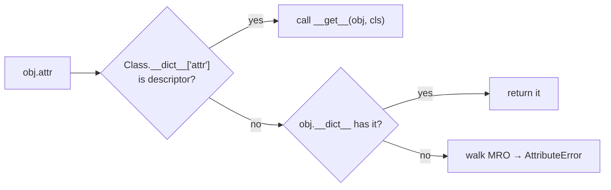
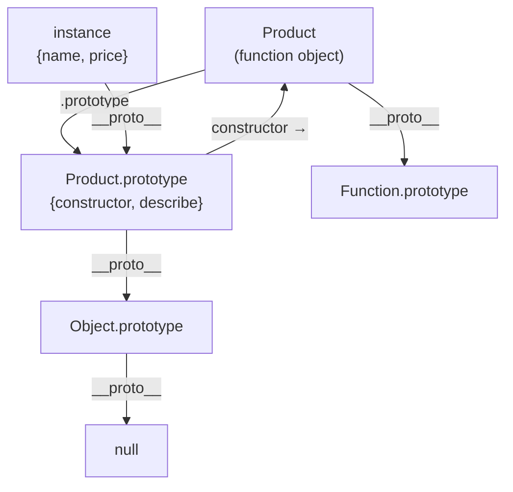

# 09 — Internals & Advanced Machinery 🔬⚙️

> This is the "how the engine actually works" chapter. Everything here is real — not metaphor.

---

## A. Object creation — the deepest level

### 🐍 `__new__` vs `__init__`

```python
class Product:
    def __new__(cls, name, price):
        print("__new__: creating raw object")
        return super().__new__(cls)          # allocate the object

    def __init__(self, name, price):
        print("__init__: filling it")
        self.name, self.price = name, price

Product("Mouse", 1000)
# __new__: creating raw object     ← FIRST
# __init__: filling it             ← SECOND
```

```
Product("Mouse", 1000)
  └─► Product.__call__  (the metaclass hooks in!)
        ├─► obj = Product.__new__(Product, "Mouse", 1000)   # creation
        ├─► Product.__init__(obj, "Mouse", 1000)            # initialization
        └─► return obj
```

**When do YOU override `__new__`?**
1. Immutable types (your `NormalizedEmail` — a `str`'s value is set at creation)
2. Singletons — control whether a new object is even created:

```python
class Singleton:
    _instance = None

    def __new__(cls):
        if cls._instance is None:
            cls._instance = super().__new__(cls)
        return cls._instance                 # same object every time!

a, b = Singleton(), Singleton()
a is b     # True
```

### ⚡ `new` + `Reflect.construct` equivalent

```js
// The 4 steps again, this time written manually:
function manualNew(Cls, ...args) {
  const obj = Object.create(Cls.prototype);   // steps 1+2
  const result = Cls.apply(obj, args);        // step 3
  return result instanceof Object ? result : obj;  // step 4
}
```

---

## B. Descriptors — the engine behind `@property`, methods, `self` 🔬

**THE most important internal concept in Python OOP.**

A descriptor = object with `__get__` (and maybe `__set__`, `__delete__`). Attribute access `obj.x` checks the class; if `x` is a descriptor, Python calls `x.__get__(obj, cls)` instead of returning it.

```python
class Celsius:
    def __get__(self, obj, cls):                    # read
        return obj._c

    def __set__(self, obj, value):                  # write — validation hook!
        if value < -273.15:
            raise ValueError("Below absolute zero")
        obj._c = value

class Temperature:
    celsius = Celsius()        # descriptor instance lives on the CLASS
    def __init__(self, c):
        self.celsius = c       # → Celsius.__set__ runs!

t = Temperature(25)
t.celsius = -300               # ValueError — same effect as @property!
```

🔬 **Now the reveal:** `property` IS a descriptor — and so is **every function**!

```python
# These are equivalent:
price = property(get_price, set_price)       # built-in descriptor
class price:                                  # hand-rolled
    def __get__(self, obj, cls): ...
    def __set__(self, obj, v): ...
```

```python
class Product:
    def describe(self): return "p"

p = Product()
p.describe        # bound method!
# HOW? functions implement __get__!
# p.describe → Product.describe.__get__(p, Product)
#            → method object = function + p pre-bound as self ✅
```

This explains file 03's `product.total_price` vs `Product.total_price` mystery: the **same function**, wrapped on access by its `__get__`. `staticmethod`/`classmethod` are descriptors too — they wrap `__get__` differently (staticmethod returns the raw function, classmethod binds `cls` instead of the instance).



**Full lookup order** (data descriptors win over instance dict — that's why `price` setter beats `self.price`):

```
1. data descriptor on class (__get__ AND __set__)   → wins everything
2. obj.__dict__['attr']                              → plain instance data
3. non-data descriptor / class attr / method         → functions, @property getters
4. __getattr__                                       → last-chance hook
→ AttributeError
```

### ⚡ The JS mirror: accessors + prototype

JS does it with getter/setter *properties* defined on the prototype:

```js
// What `get price() {}` in a class actually creates:
Object.defineProperty(Product.prototype, "price", {
  get() { return this._price; },
  set(v) { /* validate */ this._price = v; },
});
// Same idea as Python descriptors — attribute access runs a function.
```

---

## C. `__slots__` — memory optimization 🐍

Normal objects carry a `__dict__` (a hashmap) — flexible but heavy. `__slots__` replaces it with a fixed array:

```python
class Point:
    __slots__ = ("x", "y")
    def __init__(self, x, y):
        self.x, self.y = x, y

p = Point(1, 2)
p.__dict__        # AttributeError — no dict!
p.z = 3           # AttributeError — can't add undeclared attrs
```

For 10 million objects: `__dict__` ≈ 104 bytes/obj vs `__slots__` ≈ 56 bytes/obj — **~45% memory saved**, plus slightly faster attribute access.

⚠️ Gotchas: no dynamic attributes, weakrefs need `"__weakref__"` slot, subclasses need their own `__slots__` or they get a `__dict__` anyway.

🔬 JS has nothing like this — but its hidden-class engine does something similar automatically (see section F).

---

## D. Metaclasses — classes that make classes 🐍🧠

```python
class Product: ...
type(Product)     # <class 'type'> — classes are OBJECTS, made by `type`
type(type)        # <class 'type'> — type makes itself 🤯
```

`class X:` is sugar for `X = type("X", (bases,), namespace_dict)`:

```python
# Manual class creation — identical to `class Foo: x = 1`
Foo = type("Foo", (), {"x": 1})
Foo().x    # 1
```

Custom metaclass = run code when a class is *defined* (frameworks love this — Django models, SQLAlchemy):

```python
class Registry(type):
    plugins = {}
    def __new__(mcls, name, bases, ns):
        cls = super().__new__(mcls, name, bases, ns)
        if name != "Plugin":
            Registry.plugins[name] = cls      # auto-register every subclass
        return cls

class Plugin(metaclass=Registry): pass
class CSVPlugin(Plugin): pass
class JSONPlugin(Plugin): pass

Registry.plugins    # {'CSVPlugin': ..., 'JSONPlugin': ...}
```

Since Python 3.7+, `__init_subclass__` and `__set_name__` cover most metaclass uses without the complexity:

```python
class Plugin:
    registry = {}
    def __init_subclass__(cls, **kwargs):          # runs on EVERY subclass definition
        super().__init_subclass__(**kwargs)
        Plugin.registry[cls.__name__] = cls
```

---

## E. JS prototype internals — the whole truth 🔬

`class` is sugar over this machine:

```js
// What `class Product { constructor(){} describe(){} }` compiles to conceptually:
function Product(name, price) {           // constructor function
  this.name = name;
  this.price = price;
}
Product.prototype.describe = function() { return this.name; };
```

Key objects & links:



```js
const p = new Product("Mouse", 1000);
p.__proto__ === Product.prototype            // true  (lookup path)
p.constructor === Product                    // true  (inherited from prototype)
Product.prototype.hasOwnProperty("describe") // true  (methods live HERE)
Product.__proto__ === Function.prototype     // true  (the class itself is a function!)

// extends just chains prototypes:
class Admin extends User {}
Admin.prototype.__proto__ === User.prototype   // true
Admin.__proto__ === User                       // true  (statics inherited too!)
```

🔬 **Two chains exist:**
- `instance.__proto__` chain → instance methods (`describe`)
- `Admin.__proto__` chain → **static** methods inherited (`Admin.create()` works if `User.create` static exists)

Hand-build inheritance without `class` (pre-ES6 style, still works):

```js
function Animal(name) { this.name = name; }
Animal.prototype.speak = function() { return `${this.name} makes a sound`; };

function Dog(name) { Animal.call(this, name); }           // "super()"
Dog.prototype = Object.create(Animal.prototype);          // chain it
Dog.prototype.constructor = Dog;                          // fix constructor
Dog.prototype.speak = function() { return `${this.name} barks`; };

new Dog("Rex").speak();   // "Rex barks"
```

---

## F. Hidden classes / Shapes — why JS objects are fast ⚡🔬

Engines (V8) optimize `this.x = ...` by tracking object **shape**:

```js
const a = new Product("a", 1);   // ctor sets name, price → shape S1
const b = new Product("b", 2);   // same order → shares shape S1 (FAST)

// but if objects get different shapes:
const c = new Product("c", 3);
c.extra = true;                  // new shape S2 (deopt risk)
```

⚠️ Perf tip: always initialize **all** fields in the constructor, in the **same order**. Don't delete properties (`delete obj.x` kills the shape — set to `undefined` instead).

Python's equivalent: `__slots__` gives a fixed layout; CPython 3.11+ also caches attribute lookups via inline caches — similar spirit.

---

## G. Copying objects — shallow vs deep 🧬

```python
import copy

orig = {"cart": ["a", "b"]}
shallow = copy.copy(orig)          # new outer box, SAME inner list!
deep = copy.deepcopy(orig)         # fully independent clone

shallow["cart"].append("x")
orig["cart"]      # ['a','b','x']  — shallow leaked 😱
```

For your own classes — define `__copy__`/`__deepcopy__`, or use `dataclasses.replace`.

```js
const orig = { cart: ["a", "b"] };
const shallow = { ...orig };                  // spread = shallow copy
const deep = structuredClone(orig);           // true deep clone (Node 17+/browsers)

shallow.cart.push("x");
orig.cart;                                    // ['a','b','x'] — same leak!
```

---

## H. Reflection & introspection — objects examining themselves

```python
# 🐍
laptop.__dict__                    # instance's raw attributes
Product.__dict__                   # class attributes + methods
laptop.__class__                   # its class
Product.__mro__                    # resolution order
getattr(laptop, "name")            # dynamic read
setattr(laptop, "price", 999)      # dynamic write
hasattr(laptop, "x")               # check
vars(laptop)                       # == __dict__
dir(laptop)                        # everything reachable
callable(laptop.describe)          # True
```

```js
// ⚡
Object.keys(laptop)                // own enumerable props
Object.getOwnPropertyNames(laptop)
Object.getPrototypeOf(laptop)      // __proto__
Reflect.get(laptop, "name")        // dynamic read
Reflect.set(laptop, "price", 999)
"name" in laptop                   // check (walks chain)
laptop.hasOwnProperty("name")      // own only
Object.entries(laptop)             // [["name","Mouse"],...]
```

---

## I. Object equality & hashing 🐍

```python
class User:
    def __init__(self, uid): self.uid = uid
    def __eq__(self, other): return self.uid == other.uid
    def __hash__(self): return hash(self.uid)      # needed for sets/dict keys

u1, u2 = User(1), User(1)
u1 == u2            # True (via __eq__)
u1 is u2            # False (different objects — `is` = identity)
{u1, u2}            # {User(1)} — ONE element! __eq__+__hash__ dedupes
```

⚠️ Define `__eq__` → `__hash__` becomes `None` (unhashable) unless you define it — because equal objects MUST hash equal, and Python can't guess your logic.

```js
// ⚡ JS: == is by reference for objects, ALWAYS
{a:1} == {a:1}          // false — no dunder to hook into
// emulate with a method:
class User {
  constructor(uid) { this.uid = uid; }
  equals(other) { return this.uid === other.uid; }
}
// Or Map with custom keys — still reference equality. Use value objects via
// comparing serialized or stored uid manually.
```

---

## J. Iterators & generators inside classes

```python
class Countdown:
    def __init__(self, start): self.start = start
    def __iter__(self):                           # makes `for` work
        n = self.start
        while n > 0:
            yield n                               # generator method!
            n -= 1

list(Countdown(3))       # [3, 2, 1]
```

```js
class Countdown {
  constructor(start) { this.start = start; }
  *[Symbol.iterator]() {                 // generator method — for..of works
    for (let n = this.start; n > 0; n--) yield n;
  }
}
[...new Countdown(3)];   // [3,2,1] — spread uses the iterator!
```

---

## K. Context managers & lifecycle hooks 🐍

```python
class Timer:
    def __enter__(self):                  # with x: → runs here
        import time; self.t = time.perf_counter()
        return self
    def __exit__(self, *exc):             # block exits → runs here (even on error!)
        import time
        print(f"elapsed: {time.perf_counter()-self.t:.3f}s")

with Timer():
    sum(range(10**6))       # elapsed: 0.02s

# Cleanup hook:
class Res:
    def __del__(self): print("cleaned")   # destructor — runs at GC (don't rely on it!)
```

```js
// ⚡ modern equivalent — `using` (TC39, new) / try-finally
class Timer {
  start() { this.t = performance.now(); return this; }
  [Symbol.dispose ?? Symbol.for("dispose")]() {
    console.log(`elapsed: ${performance.now() - this.t}ms`);
  }
}
// (or just use try/finally — still the portable way)
```

---

## ✅ The mental model upgrade from this file

| Before | Now you know |
|--------|--------------|
| `obj.method()` "just works" | `__get__` descriptor binds `self` / prototype chain walk sets `this` |
| `@property` is magic | It's a descriptor object with `__get__`/`__set__` |
| `class` creates classes | `type`/metaclass creates classes; JS `class` wraps prototype wiring |
| `new` creates objects | `__new__`+`__init__` (Py) / 4-step `new` (JS) |
| Objects are dicts | Py: `__dict__` or `__slots__`; JS: hidden shapes |

➡️ **Next:** `10-composition-solid.md`
