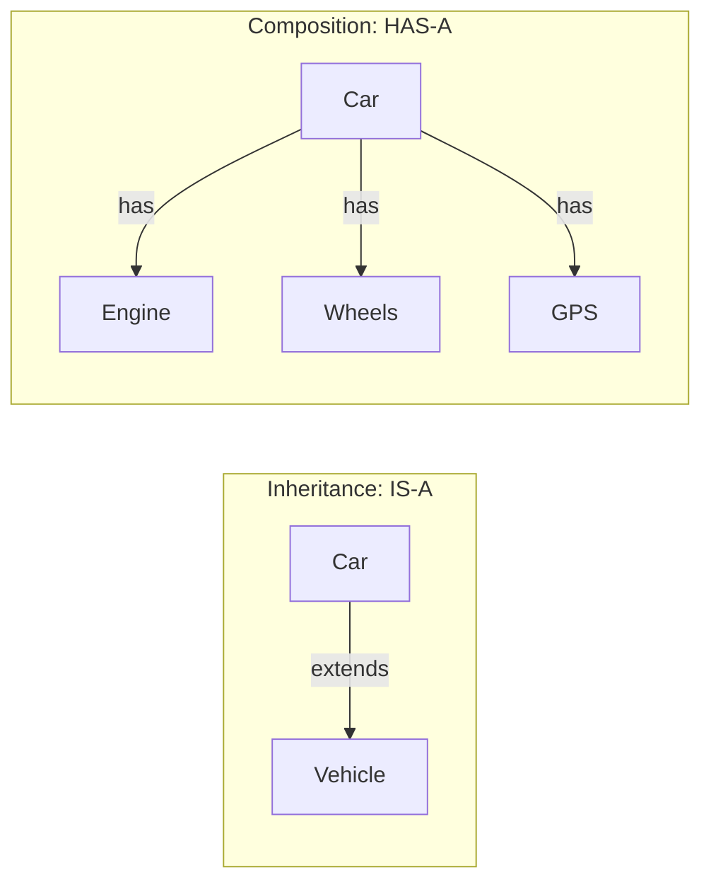
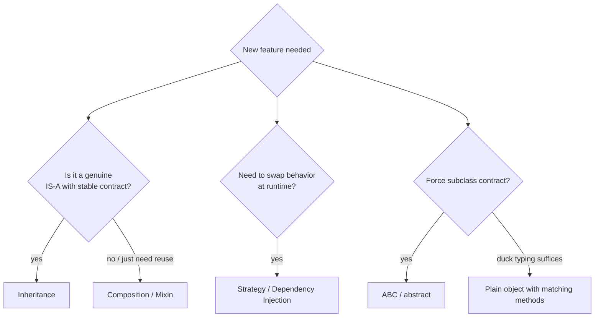

# 10 — Composition, Mixins & SOLID 🏗️

## Composition vs Inheritance — the #1 design decision

> **"Prefer composition over inheritance."** — Gang of Four



🏠 **Analogy:** a car *is a* vehicle (inheritance) but *has an* engine (composition). You don't say "a car is an engine" — the engine is a *part* you can swap.

### Why composition often wins

```python
# ❌ Inheritance forcing wrong model
class Car(Engine): ...        # "Car IS-A Engine"?? No — Car HAS-A engine

# ✅ Composition
class Engine:
    def start(self): return "vroom"

class GPS:
    def navigate(self, dest): return f"routing to {dest}"

class Car:
    def __init__(self):
        self.engine = Engine()           # Car HAS-A engine
        self.gps = GPS()                 # Car HAS-A gps

    def drive_to(self, dest):
        return f"{self.engine.start()} → {self.gps.navigate(dest)}"

Car().drive_to("airport")   # "vroom → routing to airport"
```

```js
// ⚡
class Car {
  constructor() {
    this.engine = new Engine();
    this.gps = new GPS();
  }
  driveTo = (dest) => `${this.engine.start()} → ${this.gps.navigate(dest)}`;
}
```

| | Inheritance | Composition |
|---|---|---|
| Relationship | IS-A | HAS-A |
| Coupling | Tight — child knows parent's guts | Loose — parts are swappable |
| Change impact | Parent change breaks children | Swap a part, no blast radius |
| Testing | Must test with whole hierarchy | Mock parts individually |
| Flexibility | Fixed at class-definition time | Mix parts at runtime |

```python
# Composition's superpower — swap parts at runtime
class Car:
    def __init__(self, engine=None):
        self.engine = engine or Engine()

class ElectricEngine:
    def start(self): return "silent hum"

tesla = Car(ElectricEngine())    # different engine, same Car ✅
```

---

## Mixins — small reusable "feature packs"

A **mixin** = a class with a focused feature, meant to be *mixed into* others via inheritance. It's how Python gets "multiple inheritance" benefits safely, and how JS fakes multiple inheritance.

### 🐍 Python mixins

```python
class JsonMixin:
    import json
    def to_json(self):
        return json.dumps(self.__dict__)

class LogMixin:
    def log(self, msg):
        print(f"[{type(self).__name__}] {msg}")

class TimestampMixin:
    from datetime import datetime
    def touch(self):
        self.updated_at = datetime.now()

class Product(JsonMixin, LogMixin, TimestampMixin):
    def __init__(self, name, price):
        self.name, self.price = name, price

p = Product("Mouse", 1000)
p.to_json()              # '{"name": "Mouse", "price": 1000}'
p.log("created")         # [Product] created
p.touch()
```

🔬 Mixins rely on MRO — `Product(JsonMixin, LogMixin)` → mixin methods resolve left-to-right before `Product`'s own... actually Product's own methods resolve FIRST (class before parents in MRO). Convention: mixins listed leftmost, never instantiated alone, assume the host class provides the data (`self.__dict__`).

### ⚡ JS mixin pattern

```js
// Mixins = functions that take a base class and return an extended class
const JsonAble = (Base) => class extends Base {
  toJSON() { return JSON.stringify(this); }
};

const Loggable = (Base) => class extends Base {
  log(msg) { console.log(`[${this.constructor.name}] ${msg}`); }
};

const Timestamped = (Base) => class extends Base {
  touch() { this.updatedAt = new Date(); }
};

// Compose the chain — JS "multiple inheritance"
class Product extends Timestamped(Loggable(JsonAble(Object))) {
  constructor(name, price) {
    super();
    this.name = name;
    this.price = price;
  }
}

const p = new Product("Mouse", 1000);
p.toJSON();   p.log("created");   p.touch();
```

🆚 Python mixins = multiple inheritance; JS mixins = **class factory functions** (`Base => class extends Base`) chained together — since `extends` takes an *expression*, `extends Mixin1(Mixin2(Base))` composes them.

---

## SOLID — 5 rules for OOP that ages well

### S — Single Responsibility
*A class should have ONE reason to change.*

```python
# ❌ does everything
class Report:
    def generate(self): ...
    def save_to_file(self, path): ...      # file system = 2nd job
    def email(self, to): ...               # emailing = 3rd job

# ✅ each class one job
class Report:
    def generate(self): ...
class ReportSaver:
    def save(self, report, path): ...
class ReportMailer:
    def send(self, report, to): ...
```

### O — Open/Closed
*Open for extension, closed for modification* — add behavior via new classes, not edits.

```python
# ❌ editing the function for every new discount type
def discount(customer_type, price):
    if customer_type == "regular": return price * 0.95
    if customer_type == "vip": return price * 0.8        # edited!
    if customer_type == "employee": return price * 0.5   # edited again!

# ✅ polymorphism — extend by ADDING a class
class Discount(ABC):
    @abstractmethod
    def apply(self, price): ...

class RegularDiscount(Discount):
    def apply(self, p): return p * 0.95
class VIPDiscount(Discount):
    def apply(self, p): return p * 0.80
# new type → new class, zero edits to existing code
```

### L — Liskov Substitution
*A child must be usable anywhere the parent is — without breaking expectations.*

```python
# ❌ classic violation
class Rectangle:
    def __init__(self, w, h): self.w, self.h = w, h
    def area(self): return self.w * self.h
    def set_width(self, w): self.w = w

class Square(Rectangle):
    def set_width(self, w): self.w = self.h = w   # "fixes" square-ness...

r = Square(2, 2)
r.set_width(5)
r.area()       # 25 — but for a Rectangle mental model expected 5*h! Broken 💥
```

Rule of thumb: if overriding a method *changes the guarantee* (input rules stricter, output rules weaker, invariants altered) — LSP violated → prefer composition or a different hierarchy.

### I — Interface Segregation
*Many small interfaces > one fat interface.*

```python
# ❌ fat interface — SMSNotifier forced to implement attachments?!
class Notifier(ABC):
    @abstractmethod
    def send(self, msg): ...
    @abstractmethod
    def send_with_attachment(self, msg, file): ...   # SMS can't attach files!

# ✅ segregated
class Notifier(ABC):
    @abstractmethod
    def send(self, msg): ...

class AttachmentCapable(ABC):
    @abstractmethod
    def send_with_attachment(self, msg, file): ...

class EmailNotifier(Notifier, AttachmentCapable): ...   # takes what it needs
class SMSNotifier(Notifier): ...                        # only what it can do
```

### D — Dependency Inversion
*Depend on abstractions, not concrete classes.*

```python
# ❌ Checkout is hardwired to Stripe
class Checkout:
    def __init__(self):
        self.gateway = StripeGateway()        # locked in — can't test, can't swap

# ✅ inject the dependency — Checkout depends on the CONTRACT
class Checkout:
    def __init__(self, gateway):              # any object with .charge()
        self.gateway = gateway

    def pay(self, amount):
        return self.gateway.charge(amount)

Checkout(StripeGateway())
Checkout(FakeGateway())          # testing: inject a mock — free unit tests!
```

```js
// ⚡ same
class Checkout {
  constructor(gateway) { this.gateway = gateway; }
  pay = (amount) => this.gateway.charge(amount);
}
new Checkout({ charge: (a) => `fake charged ${a}` });   // mock = any matching shape
```

This is **dependency injection** — the gateway is passed IN rather than created inside. It's why duck-typed languages shine: the "abstraction" doesn't even need to be a declared interface.

---

## Design patterns — quick tour (full detail beyond scope, know the names)

| Pattern | One-liner | Where you've seen it |
|---------|-----------|----------------------|
| **Singleton** | one instance ever | `__new__` guard (file 09), DB connections |
| **Factory** | method that builds objects | `Product.from_dict()`, `cls(...)` |
| **Builder** | step-by-step construction | chained `.add().add()` |
| **Observer** | objects subscribe to events | DOM `addEventListener`, `pub/sub` |
| **Strategy** | swap algorithm at runtime | pass a different `Discount` |
| **Template Method** | fixed skeleton, child fills steps | file 08's `DataExporter` |
| **Decorator** | wrap objects to add behavior | `@property`, `functools.wraps` |
| **Iterator** | uniform traversal | `__iter__`, `Symbol.iterator` |

### Strategy pattern — full mini example

```python
class Sorter:
    def __init__(self, strategy):            # inject algorithm
        self.strategy = strategy

    def sort(self, products):
        return sorted(products, key=self.strategy)

sorters = {
    "cheapest": Sorter(lambda p: p.price),
    "name":     Sorter(lambda p: p.name),
}
sorters["cheapest"].sort(products)     # swap strategy = swap behavior
```

```js
const sorter = keyFn => products => [...products].sort((a,b) => keyFn(a) - keyFn(b));
const cheapest = sorter(p => p.price);
cheapest(products);
```

---

## ✅ Design decision flowchart



➡️ **Next:** `11-capstone-projects.md`
